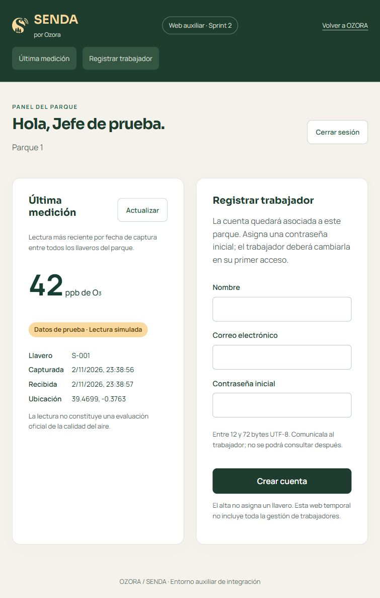
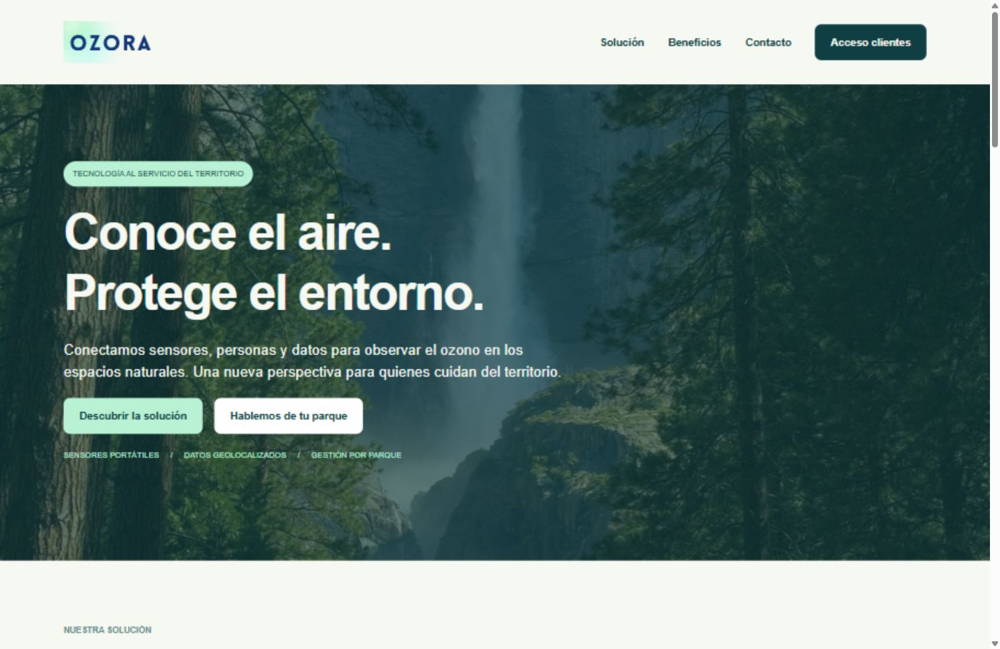
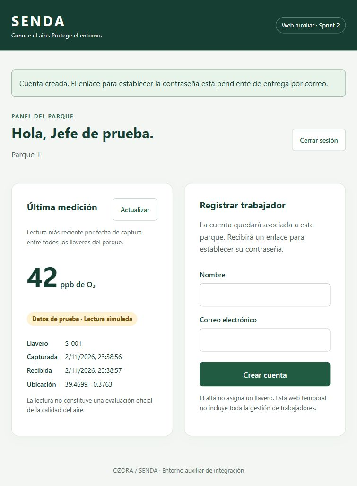
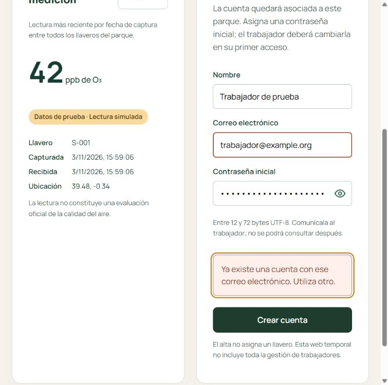

<!--
Nombre: evidencia-backend.md
Descripción: Resultado de la verificación local del backend y web auxiliar.
Copyright: (c) 2026 Equipo 2 - SENDA / OZORA.
Fecha: 02/11/2026
Autor: Julia (con asistencia de Codex).
Aportación: Registrar pruebas ejecutadas y límites de la evidencia.
-->

# Evidencia del backend Sprint 2

Verificación local realizada el 02/11/2026 sobre `feature/backend-web-simulacion`, basada en `develop` (`7dc6588`). Herramientas: PHP 8.4.27, MySQL 8.4.13, Windows y navegador integrado. BD de pruebas independiente `senda_test`; demo en `senda_local`.

| Comprobación ejecutada | Resultado |
|---|---|
| Sintaxis de los archivos PHP añadidos/modificados | Sin errores |
| Sintaxis JavaScript (`node --check`) | Sin errores |
| Análisis del script PowerShell | Sin errores |
| `php tests/validacion.php` | 25 comprobaciones correctas |
| `php tests/integracion.php`, ejecución final con contraseña inicial y cambio propio | 203 comprobaciones HTTP/MySQL correctas |
| Importación del SQL en las dos bases vacías | Correcta |
| Navegador: login de jefe, parque sin datos y actualización | Correcto |
| Captura ficticia enviada mediante login + POST de la API | Guardada; visible como 42 ppb de S-001 |
| Navegador: alta de trabajador ficticio | Cuenta creada; enlace encolado |
| Buzón local y uso de enlaces en pruebas HTTP | Alta y recuperación correctas |

Las 203 comprobaciones cuentan tanto estados HTTP y estructura de respuesta como aserciones sobre datos: no representan 203 historias o endpoints distintos. No contienen tokens ni datos personales reales. La ampliación comprueba el guardado real de una solicitud pública, el rechazo de campos incorrectos, la ausencia de listado público, las páginas OZORA/acceso y la disponibilidad de logos, fotografía y fuentes locales.

Actualización del 03/11/2026: alta con contraseña inicial elegida por el jefe, guardada como hash y no devuelta; rechazo de alta sin contraseña o demasiado corta; indicador de cambio obligatorio en el login; bloqueo de operaciones antes del cambio; verificación de contraseña actual; rechazo de nueva contraseña idéntica o intento de elegir otra cuenta; cambio correcto, revocación de todas las sesiones y rechazo de la contraseña inicial después. El cambio se prueba por HTTP como lo consumirá Android, sin cambiar cuentas de la demo. Las capturas anteriores corresponden a la versión previa de la interfaz.

Comprobado en navegador el formulario actualizado del jefe, con el campo de contraseña inicial:

Cobertura de integración: credenciales incorrectas; cuenta y organización inactivas; sesiones válidas, caducadas, revocadas por logout o cambio de contraseña; rol de jefe y trabajador; aislamiento de dos organizaciones y parques; llavero ajeno/inactivo; JSON incorrecto, arrays, tipo MIME erróneo y cuerpo grande; validación sin inserciones; guardado confirmado; reintento sin duplicar; conflicto sin sobrescribir; milisegundos y precisión completa de coordenadas; última captura entre varios llaveros, empates y orden diferente al de recepción; reasignación sin trasladar histórico; alta con correo único y sin inyección de parque; enlace de alta; respuesta genérica de recuperación; token caducado, consumido y cuenta desactivada; revocación de sesiones; métodos y rutas incorrectos; límite de intentos; archivos privados inaccesibles por HTTP.

La verificación de precisión incluye coordenadas con más decimales de los que preserva la conversión automática de PHP a string. El guardado conserva esos valores para evitar falsos conflictos en reintentos.

## Web pública e identidad visual

Revisadas la conversación «Diseñar identidad visual en Figma», la arquitectura de la carpeta secundaria y los contextos de Figma de `54:220` (OZORA) y `59:1206` (SENDA). Se han incorporado sus recursos originales y fuentes locales. Se conserva el alcance funcional actual del panel; no se han añadido métricas o listados ficticios al área privada.

Comprobaciones en navegador: portada desktop a 1512 px, acceso real de jefe y última medición, formulario público con datos ficticios y confirmación del servidor, recursos visuales cargados y sin errores de consola. Vista móvil a 390 px: corregido un desbordamiento de las tarjetas de solución; portada y panel sin desbordamiento horizontal. Verificado el enlace antiguo `/#token=...` con token ficticio: conduce al formulario de `/acceso` y limpia el fragmento, sin cambiar contraseñas.

Otras evidencias: [OZORA móvil](evidencias/ozora-movil.jpg) y [panel con identidad SENDA](evidencias/panel-senda-figma.jpg).

Captura de la demo, con cuentas, coordenadas y medición ficticias:

## Límites

Actualización de roles y formularios del 03/11/2026: 216 comprobaciones HTTP/MySQL correctas y 25 de validación. Se prueban reintentos de alta con el mismo correo, mayúsculas y espacios, ausencia de una segunda fila, protección UNIQUE desde SQL directo y aceptación de nombres iguales con correos distintos. El alta utiliza ROLES; se rechazan roles inexistentes y trabajadores sin parque. La migración local conserva las cuentas, sus estados y hashes; una instalación nueva en una base aislada crea 11 tablas y 4 roles. En Plesk se conserva el total de tres usuarios y se han comparado sus tres hashes con la copia anterior, sin cambios.

Verificación visual en Plesk: aviso de correo repetido dentro de `form-alta`, foco en el aviso y correo con `aria-invalid=true`; icono de ojo junto a la clave. La captura usa exclusivamente la cuenta ficticia de trabajador. Los mensajes de éxito y error de cada formulario tienen una región accesible propia, en vez de depender del aviso global situado al principio de la página.

Comprobación parcial en Plesk del 03/11/2026: portada y acceso servidos por HTTPS en `/senda`, solicitud ficticia guardada en MySQL y confirmada en phpMyAdmin; sesión sin credenciales rechazada con 401 y configuración privada inaccesible con 404. El esquema está importado y la conexión configurada. Cuentas de demo importadas por la propietaria. Reproducido y corregido el fallo de reenvío de Authorization entre Apache y PHP-FPM: login correcto seguido de sesión 401 antes del arreglo, sesión 200 después. Login del jefe confirmado en navegador hasta la pantalla de cambio obligatorio. Verificado el botón Mostrar/Ocultar cambiando el tipo del campo sin enviar el formulario; disponible también en cambio inicial, recuperación y alta. Cambio personal de contraseña completado por la propietaria; panel del jefe y botón Actualizar comprobados en Plesk, con la lectura simulada de 42 ppb del llavero S-001. Tras el arreglo se han repetido las 203 comprobaciones HTTP/MySQL locales, todas correctas.

No se ha probado SMTP/correo a destinatarios reales, carga concurrente, Android en teléfono, BLE físico ni persistencia de recorridos. Las comprobaciones de Plesk no sustituyen la integración completa con Android ni validan toda la configuración del servidor.

La web auxiliar apoya HU-09, sin cubrir toda la gestión de trabajadores ni asignación y cupos de llaveros. HU-18 y HU-21 requieren además validar su integración con los clientes Android antes de cerrar las historias completas.

Guía de reproducción: `doc/backend-puesta-en-marcha.md`. El servidor de pruebas necesita la misma `SENDA_CONFIG` que el comprobador. No ejecutar las pruebas de integración sobre datos de producción.
